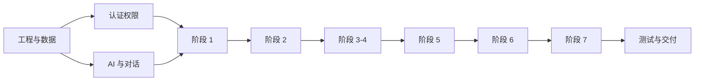

# task.md · MVP 实施任务清单

依据：`plan.md` V0.3  
周期：5 个工作日  
用法：按组顺序执行；完成后在编号前打勾。P0 必须完成，P1 延期时按第 12 节顺序砍。

规模：S < 1 小时，M 约 1–3 小时，L 约半天。



---

## 1. 里程碑

| 里程碑 | 时间 | 通过标准 |
| --- | --- | --- |
| M0 底座可跑 | D1 结束 | 登录 → 新建项目 → 对话界面可发消息；种子可重复执行 |
| M1 需求诊断闭环 | D2 结束 | 上传资料 → 事实 + 引用 → 追问 → 任务地图与关键路径 |
| M2 建议书与采购闭环 | D3 结束 | 建议书 → 选服务 → RFP → 报价 → 比价 → 总报价 |
| M3 签约与审查闭环 | D4 结束 | 合同双确认 → 看板 → 答复审查 → 律师批准质询 |
| M4 验收与交付 | D5 结束 | 专家盲评 → 解锁 → 归档 → 重置 → 脚本跑通 3 次 |

---

## 2. 工程与数据

| 编号 | P | S | 任务 | 验收 | 依赖 |
| --- | --- | --- | --- | --- | --- |
| ☑ A01 | P0 | M | 仓库骨架：Flask 应用工厂、`config.py`、`extensions.py`、`wsgi.py`、健康检查；Vite + Vue 3 + Element Plus + Router + Pinia + axios 代理；`.env.example`、`.gitignore` | `/api/health` 返回 200；`npm run dev` 可打开；前端请求经代理到 5000 | — |
| ☑ A02 | P0 | L | 24 张表模型与 `create_all`（A 18 + C 2 + F 2 + H 1 + I 1）：users、config_items、access_tokens、projects、documents、facts、task_templates、tasks、proposals、providers、candidates、rfps、quotes、client_quotes、contracts、milestones、findings、query_letters、knowledge_chunks、audit_logs、conversations、messages、performance_events、archives | 空库可建；表名与计划一致；金额用整数分；主键 UUID；SQLite 开启 WAL | A01 |
| ☑ A03 | P0 | M | 种子基础：配置项、客户/PM/律师/管理员/服务商/专家六个账号、10 家服务商 | 重复执行不重复插入；向导只返回 `enabled=1` 的选项 | A02 |
| ☑ A04 | P0 | L | 30 项任务模板：从 `典型案例.md` 第十二节录入，含阶段、周期、费用区间、前置任务、交付物、所需信息、法规依据、复核日期 | 30 条齐全；依赖可解析；关键路径为 T01→T13→T14→T16→T17→T23→T18→T29 | A02 |
| ☑ A05 | P0 | M | 知识库切块：解析 `rag/01`–`rag/08` 的 front matter，按 `#`/`##` 与中文序号切块，500–800 字、重叠 100 字 | 8 个文档入库；chunk 含标题路径与字符区间；front matter 不进正文 | A02 |
| ☑ A06 | P0 | L | 演示数据：演示项目、8 条审查发现、40 万报价与 7 万管理费、种子数据 | 演示项目阶段、任务、报价与案例一致 | A03 A04 A05 |
| ☑ A07 | P0 | S | 种子幂等与一键重置：`seed` 可重复执行，`reset` 清空演示项目后重建 | 连续执行两次数据不翻倍；reset 后状态回到初始 | A06 |

---

## 3. 认证、权限与配置

| 编号 | P | S | 任务 | 验收 | 依赖 |
| --- | --- | --- | --- | --- | --- |
| ☑ B01 | P0 | M | 登录与 JWT：密码哈希、签发、过期、当前用户接口 | 三个内置账号可登录；错误密码 401；无 token 访问业务接口 401 | A03 |
| ☑ B02 | P0 | M | 一次性令牌：生成、校验、过期、作废，记录 IP 与访问时间 | 令牌 ≥ 128 bit；过期/作废返回 401；访问后记录 IP | A02 |
| ☑ B03 | P0 | M | 角色装饰器与项目级隔离：PM、律师、管理员；外部令牌按角色限制 | 越权访问项目返回 403；律师不能改报价；管理员不能代审批 | B01 B02 |
| ☑ B04 | P0 | S | 审计日志 helper：动作、对象、详情、IP、时间，只增不改 | 创建项目、审批、发送、归档均写入日志 | A02 |

---

## 4. AI 与对话工作台

| 编号 | P | S | 任务 | 验收 | 依赖 |
| --- | --- | --- | --- | --- | --- |
| ☑ C01 | P0 | M | `AIProvider`：DeepSeek OpenAI 兼容调用、JSON 输出、超时重试 1 次；记录步骤、耗时、token | 有 Key 走真实接口；无 Key 返回 503；失败返回明确错误 | A01 |
| ☑ C02 | P0 | M | `POST /api/chat`：SSE 流式返回，按阶段路由到访谈/任务/建议书等意图，消息落库 | curl 可见逐块输出；消息可回看；不阻塞其他接口 | C01 A02 |
| ☑ C03 | P0 | S | 流式输出：服务端按 10ms 分块推送 DeepSeek 返回文本 | 对话有打字效果；失败提示明确 | C01 |
| ☑ C04 | P0 | L | 前端 ChatShell：左栏项目/会话、中栏消息流与输入框、Markdown + DOMPurify、流式光标、快捷指令 | 可新建对话、发消息、看到流式回复；刷新后消息仍在 | A01 C02 |
| ☑ C05 | P0 | L | 右侧产物面板：Tab 事实/任务/建议书/报价/节点/发现；引用 chip 点击打开原文并高亮；可全屏 | 面板随阶段切换；引用 100% 可定位；全屏可打印 | C04 |

---

## 5. 阶段 1：需求诊断

| 编号 | P | S | 任务 | 验收 | 依赖 |
| --- | --- | --- | --- | --- | --- |
| ☑ D01 | P0 | M | 文档上传与解析：txt/docx/文本型 PDF，保存文本、页码与字符位置；失败提示人工录入 | 上传 docx 与 PDF 均能取到文本；超 50MB 拒绝 | A02 |
| ☑ D02 | P0 | S | AI 访谈：按模板所需信息与缺失事实生成问题，每轮最多 5 个、最多 3 轮 | 问题按影响任务排序；回答“不知道”记为未知不阻断 | C02 A04 |
| ☑ D03 | P0 | M | 事实抽取与引用核对：状态 confirmed/assumption/unknown；归一化后精确或 3-gram Jaccard ≥ 0.85 视为通过 | 每条事实有来源；核对失败标 `citation_unverified` | D01 D02 C01 |
| ☑ D04 | P0 | M | 任务地图：实例化 30 项模板，处理模板外任务，计算依赖与关键路径，支持“租厂房/园区外买地”变体 | 任务与案例一致；买地变体新增 T11 前置且关键路径变长 | A04 D03 |
| ☑ D05 | P0 | M | 任务地图 UI：列表 + ECharts 依赖图，关键路径高亮，显示与上一版差异 | 图可缩放；关键任务有标记；变体切换有差异提示 | D04 C04 |
| ☑ D06 | P0 | M | 需求确认书：生成、打印、客户令牌确认，记录时间与 IP | 客户链接可打开并确认；重复确认不覆盖首次记录 | B02 D04 |

---

## 6. 阶段 2：项目建议书

| 编号 | P | S | 任务 | 验收 | 依赖 |
| --- | --- | --- | --- | --- | --- |
| ☑ E01 | P0 | M | RAG 关键词检索：国家/行业过滤、分词、同义词、top-k 8、返回标题路径与字符区间；`last_reviewed` 超 180 天提示 | 用 BOI/环评/工作许可检索能命中对应文档；引用位置准确 | A05 |
| ☑ E02 | P0 | L | 建议书生成：8 章 JSON，预算低/中/高并标注来源与假设，不披露服务商名称，固定“非正式报价”声明 | 8 章齐全；无具体服务商名；预算有依据 | E01 C01 D04 |
| ☑ E03 | P0 | M | 建议书版本与流程：版本号、PM 审核、发送客户、客户确认/需修改 | 修改后生成新版本；客户确认记录时间与 IP | E02 B02 |
| ☑ E04 | P0 | M | 建议书 UI 与打印：章节导航、预算表、版本对比（P1 可简化）、打印样式 | 打印无侧栏；页码与声明完整 | E03 C05 |

---

## 7. 阶段 3–4：选服务、询价、报价

| 编号 | P | S | 任务 | 验收 | 依赖 |
| --- | --- | --- | --- | --- | --- |
| ☑ F01 | P0 | M | 服务目录与选择：由任务模板映射服务项，按阶段展示；缺前置时提示；PM 代选必须填原因 | 依赖提示正确；代选写审计日志 | A04 B03 |
| ☑ F02 | P0 | M | 候选服务商：按任务与类型匹配打分，每任务 5 家，展示证据成熟度与来源；支持手工添加与标记不合适 | 每家候选有理由；至少 1 家标“新发现” | A03 |
| ☑ F03 | P0 | M | RFP 生成：中英模板、默认隐去客户名、PM 可编辑、每家服务商独立令牌链接、记录打开时间 | 链接可打开；打开时间可追踪；PM 批准后才能发送 | B02 F02 |
| ☑ F04 | P0 | M | 报价提交与解析：表单 + 粘贴文本，抽取币种、明细、假设、不含项、付款条件，PM 可修正 | 40 万样例解析逐项正确；原文可查看 | F03 C01 |
| ☑ F05 | P0 | M | 比价：并排对比金额、范围、假设、不含项，差异高亮 | 差异项明确；币种与金额无误 | F04 |
| ☑ F06 | P0 | L | 客户总报价：服务商费用 + 律所费用 + 管理费，费率可改、显示占比、版本化、客户确认、打印 | 40 万 + 7 万 = 47 万；改费率重算；确认记录 IP | F05 B02 |
| ☑ F07 | P0 | M | 报价 UI：报价列表、对比表、总报价编辑器、打印 | 全流程可在一个页面完成 | F05 F06 C05 |

---

## 8. 阶段 5：签约与节点

| 编号 | P | S | 任务 | 验收 | 依赖 |
| --- | --- | --- | --- | --- | --- |
| ☑ G01 | P0 | L | 合同生成：委托确认单、服务商委托单、SLA 条款 JSON、节点表；文件哈希 | 节点覆盖已选服务；每节点有验收人、标准、截止日 | F01 F06 |
| ☑ G02 | P0 | M | 双确认与状态机：PM 复核 → 客户确认 → 服务商确认 → 生效；未双确认不能进入执行 | 单方确认后状态仍为待确认；双确认后进入 active | B02 G01 |
| ☑ G03 | P0 | M | 合同 UI 与打印：条款、双方确认记录、打印含“不构成电子签名”声明 | 打印内容与在线记录一致 | G02 C05 |

---

## 9. 阶段 6：履约、审查、验收

| 编号 | P | S | 任务 | 验收 | 依赖 |
| --- | --- | --- | --- | --- | --- |
| ☑ H01 | P0 | M | 交付看板：里程碑、依赖、关键路径、逾期状态、阶段汇总 | 逾期与关键任务优先显示；数据与节点表一致 | G02 |
| ☑ H02 | P1 | S | 提醒与催办草稿：到期前 7/3/1 天、逾期 1/3/7 天生成提醒；服务商英文、客户中文草稿 | 提醒时间正确；草稿需 PM 批准后复制 | H01 C01 |
| ☑ H03 | P0 | L | 审查规则引擎：七类检查、三级严重程度、结论分级；`verified_error` 无来源自动降级；引用核对；法律类标记 | 8 条样例分级正确；无来源必降级；引用失败不入函 | D03 A02 |
| ☑ H04 | P0 | M | AI 审查调用：答复文本 + 项目事实 → findings，落库并关联提交 | 8 条发现可复现；每条有原文引用与中英追问 | H03 C01 |
| ☑ H05 | P0 | L | 三栏审查 UI：左原文高亮、中发现列表、右详情与追问；筛选类别/严重程度/法律类 | 点击发现跳原文；法律类进入复核待办 | H04 C05 |
| ☑ H06 | P0 | L | 质询函：按服务商合并、律师批准/驳回（误报需填原因）、发送拦截、逐条回复与关闭 | 未批准发送返回 403；批准后可发；关闭记录完整 | H05 B03 |
| ☑ H07 | P0 | M | 交付物提交与 PM 初审：服务商令牌上传、PM 通过/退回并填意见 | 退回后可重新提交；记录轮次 | H01 B02 |
| ☑ H08 | P0 | M | 专家邀请与盲评载荷：生成专家令牌；接口白名单剔除服务商、报价、内部备注 | 专家接口无敏感字段；令牌过期不可用 | H07 B02 B03 |
| ☑ H09 | P0 | L | 专家评分：四维权重 30/40/20/10、意见必填、利益冲突声明、提交后锁定、汇总结论 | 提交后修改返回 403；总分计算正确 | H08 |
| ☑ H10 | P0 | M | 验收结论与解锁：通过/有条件通过/不通过；不通过进入整改；通过后解锁依赖任务并写履约事件与评分 | 不通过时依赖任务仍锁定；通过后解锁 | H09 D04 |
| ☑ H11 | P0 | M | 验收 UI 与专家链接页：交付物、评分表、意见、结论、整改轮次 | 专家页无服务商与报价；PM/客户视图完整 | H09 C05 |

---

## 10. 阶段 7：归档与指标

| 编号 | P | S | 任务 | 验收 | 依赖 |
| --- | --- | --- | --- | --- | --- |
| ☑ I01 | P0 | M | 复盘与知识沉淀：复盘草稿、报价基准（最低/中位/最高）、已关闭质询入库 | 报价基准按国家 + 任务汇总；质询可按任务检索 | H10 A05 |
| ☑ I02 | P0 | M | 归档：manifest、zip、哈希、保管期限、项目只读 | zip 离线可打开；manifest 与文件一一对应；归档后写接口 409 | I01 |
| ☑ I03 | P1 | S | 指标页：有效质询率、重大事项关闭率、节点按期率可算；有效匹配率、实际可承接率显示“数据不足” | 数字可追溯到记录 | I01 H10 |
| ☑ I04 | P0 | M | 归档 UI 与演示重置：归档列表、下载、只读状态、一键重置入口 | 重置后回到 M0 初始状态 | I02 A07 |

---

## 11. 测试与交付

| 编号 | P | S | 任务 | 验收 | 依赖 |
| --- | --- | --- | --- | --- | --- |
| ☑ J01 | P0 | M | 五条硬规则测试：法律质询审批、已核实错误来源、节点解锁、专家脱敏、配置化 | `pytest` 全绿；每条测试可单独运行 | H06 H10 B02 A03 |
| ☑ J02 | P0 | S | 计算单测：关键路径、客户总价与管理费、专家加权总分 | 固定样例断言通过 | D04 F06 H09 |
| ☑ J03 | P0 | S | 种子与重置测试：连续 seed 两次、reset 后数据一致 | 无重复数据；reset 后状态可复现 | A07 |
| ☑ J04 | P1 | M | UI 打磨：空态、加载、错误提示、打印 CSS、1366 宽适配 | 无空白页；错误有可读提示；打印正常 | 全部页面 |
| ☑ J05 | P0 | S | 文档：`docs/runbook.md`、`docs/ui.md`、`docs/demo-script.md` | 新机器按 runbook 30 分钟内启动 | J01 |
| ☑ J06 | P0 | L | 演示彩排与修缺陷：准备演示数据、连续 3 次跑通 10 分钟脚本 | 3 次无中断；已配置真实 Key 与网络；无严重缺陷 | J01–J05 |

---

## 12. 延期裁剪顺序

从先砍到后砍：

1. I03 指标页细节。
2. E04 建议书版本对比 UI（保留版本数据）。
3. F03 英文 RFP 精修（保留英文模板）。
4. H02 催办草稿多语言（保留中文）。
5. F02 候选证据展开。
6. J04 非关键页面打磨。

绝不砍：五条硬规则、状态机、审批拦截、节点解锁、配置化、一键重置、归档包。

---

## 13. 完成定义（DoD）

每个任务完成需同时满足：

- 接口有权限校验与错误返回；不靠前端隐藏。
- 状态变化走 `services/state_machine.py`，不直接改字段。
- 关键动作写审计日志。
- 前端有加载态、空态、错误态。
- 涉及 AI 的输出带“草稿”标签与确认动作。
- 涉及金额、比例、日期有单元测试或固定样例验证。
- 页面在 1366×768 下不横向滚动。

---

## 14. 每日验收命令

```bash
# 后端
cd backend
python -m app.seeds.seed
pytest -q
waitress-serve --port=5000 wsgi:app

# 前端
cd frontend
npm run dev
```

每天结束必须能：

1. 登录并进入对话工作台。
2. 新建或载入演示项目。
3. 完成当天里程碑对应的演示动作。
4. 执行一键重置后重复上述动作。
