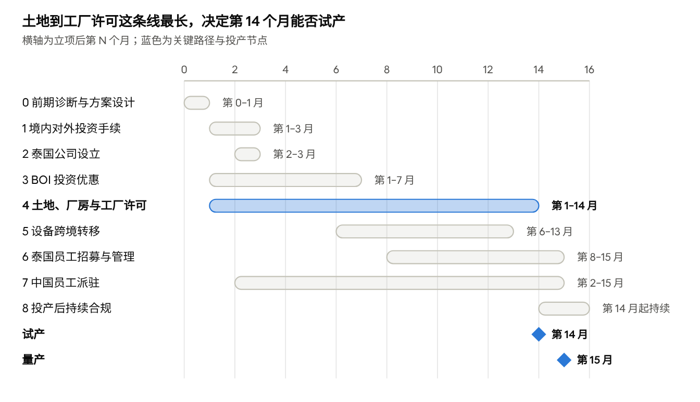

# 典型案例 · 中资制造企业赴泰国建厂：服务流程、工作内容与交付成果

Nov 7, 2026 · @Clarence Ye

一家中国制造企业从决定去泰国建厂，到工厂投产，大约需要 15 个月，涉及约 30 项专业任务、十类以上的服务商，横跨中泰两国的监管体系。本文用一个虚构但典型的案例，把平台为这类客户做的事情按阶段拆开：每一步做什么、谁来做、交付什么、依赖什么。工程师可以把它当作原型的主演示场景和任务模板库的来源。法规细节以项目执行时合作律所的确认为准。

## 一、案例设定

| 项目 | 设定 |
| --- | --- |
| 投资方 | 长三角某民营汽车零部件制造企业（下称“客户”） |
| 投资目的 | 跟随主机厂客户在泰国就近供货，分散关税与供应链风险 |
| 投资总额 | 约 3,000 万美元，其中约 800 万美元以国内在用设备实物出资 |
| 持股 | 泰国公司由客户直接或经香港子公司 100% 持股，申请 BOI 投资优惠 |
| 选址 | 泰国东部经济走廊（EEC）春武里或罗勇府，优先考虑 IEAT 工业园区 |
| 设备 | 国内在用设备（3–8 年）转移一部分，其余新购 |
| 人员 | 投产时约 300 人，其中中国派驻约 20 人 |
| 目标 | 立项后第 14 个月试产，第 15 个月量产 |

## 二、总体路线图

全流程分为九个阶段，大部分阶段并行推进。决定工期的关键路径是：**取得土地权利 → 建筑许可 → 厂房建设 → 竣工验收 → 工厂经营许可 → 试产**。另一条硬依赖是：**境内对外投资手续办完，资金和设备才能出境**。

| 阶段 | 时间窗口（立项后第 N 月） | 核心产出 | 关键依赖 |
| --- | --- | --- | --- |
| 0 前期诊断与方案设计 | 第 0–1 月 | 投资架构、选址短名单、BOI 可行性、总预算与时间表 | — |
| 1 境内对外投资手续（ODI） | 第 1–3 月 | 发改备案通知书、企业境外投资证书、外汇登记 | 阶段 0 的投资方案 |
| 2 泰国公司设立 | 第 2–3 月 | 公司注册、银行账户、税务登记 | 注资须在 ODI 完成后 |
| 3 BOI 投资优惠 | 第 1–7 月 | BOI 批复与投资优惠证书 | 可先以母公司名义申请，取证前须完成泰国公司设立 |
| 4 土地、厂房与工厂许可 | 第 1–14 月 | 土地权利、建筑许可、环评、厂房、工厂经营许可 | 园区外购地需 BOI 土地权利；建筑许可以土地权利为前提 |
| 5 设备跨境转移 | 第 6–13 月 | 设备清单获批、出口报关、进口免税、安装调试 | BOI 证书；实物出资已列入 ODI；厂房具备安装条件 |
| 6 泰国员工招募与管理 | 第 8–15 月 | 人事制度、招聘、社保登记、工作规章 | 公司设立；投产计划 |
| 7 中国员工派驻 | 第 2–15 月 | 外派协议、签证与工作许可 | BOI 批准外籍岗位；泰籍员工比例 |
| 8 投产后的持续合规 | 第 14 月起持续 | BOI 开业检查、税务申报、中泰两侧年报 | 工厂经营许可 |

路线图 · 九个阶段与投产节点（立项后第 0–16 个月）

土地与工厂许可从第 1 个月延续到第 14 个月，是贯穿始终的关键路径；其余阶段大多可以在它下面并行推进。

## 三、阶段 0：前期诊断与方案设计

**目标**：一个月内把“去泰国建厂”变成一份可以拍板的方案：用什么架构投、建在哪里、拿什么优惠、花多少钱、多久投产。

**工作内容**

- **投资架构**：中国公司直接持股，还是经香港或新加坡中间层持股。比较股息预提税、税收协定待遇、未来融资与退出的便利，以及中间层带来的境外再投资报告义务。
- **监管定性**：判断项目走“备案”还是“核准”（是否涉及敏感国家地区或敏感行业）；设备、技术或派驻技术人员是否可能涉及限制出口的技术或两用物项。837 号令明确禁止通过派遣技术人员、跨境技术指导等方式未经许可转移限制出口的技术（[中伦解读](https://www.zhonglun.com/research/articles/56237.html)）。
- **选址**：IEAT 工业园区与园区外土地的比较；东部经济走廊的额外优惠；行业是否受到 BOI 对外资控股与土地权利的新限制（[Tilleke & Gibbins](https://www.tilleke.com/insights/thailand-restricts-foreign-land-ownership-and-shareholding-for-certain-promoted-investments/?page=17)）。
- **BOI 可行性**：对应的鼓励活动与优惠等级、最低投资额、外资持股条件、二手设备政策。
- **税负与预算**：泰国企业所得税及 BOI 免税期、股息汇回的税负、关联交易定价；总投资预算与资金来源（自有资金、银行贷款、内保外贷）。
- **文件准备**：中国公司文件在泰国使用需办理公证与认证，尽早启动。

**服务商**：关联律所（中国法与对外投资监管）、泰国律所（BOI 与外资准入）、跨境税务顾问、工业园区招商方或工业地产顾问。

**平台的工作**：用 M1 生成事实表和任务地图；向客户发出追问清单（设备年限与价值、是否涉及核心工艺、员工规模、产品销往哪里、资金来源）；组织一次中泰专业人员联合方案会；把各方意见整理成一份决策备忘录。

**交付成果**

- 投资方案决策备忘录（中文）：架构、选址建议、BOI 路径、税负测算、风险清单
- 项目总计划：任务地图、时间表、预算
- 各任务的服务商短名单

## 四、阶段 1：境内对外投资手续（ODI）

**目标**：在资金和设备出境之前，取得发改、商务、外汇三个环节的手续。这是全项目的第一道硬门槛。

**监管框架（2026 年新变化）**

- 《国务院关于对外投资的规定》（国务院令第 837 号）自 2026 年 7 月 1 日施行，发改和商务部门继续实行“备案为主、核准为辅”，并引入对外投资安全审查（[新浪财经](https://cj.sina.com.cn/articles/view/1867305970/6f4cd3f200101s9t8)）。
- 国家发改委《对外投资管理办法》（发改委令 2026 年第 49 号）于 2026 年 10 月 22 日公布、**12 月 1 日起施行**，取代 2017 年的 11 号令；继续“核准 + 备案”框架，年度报告截止日为每年 6 月 30 日（[锦天城](https://www.allbrightlaw.com/CN/10475/A39A6E372F473859.aspx)）。
- 商务主管部门备案后颁发《企业境外投资证书》，地方企业向所在地省级商务主管部门备案（[商务部](https://www.mofcom.gov.cn/cms_files/filemanager/1077459795/attach/20255/0a90f8f208cc4198a8713fbfc7cfef25.pdf)）。
- 企业凭主管部门的书面凭证，到受权商业银行办理外汇登记并换汇出境（[汉坤](https://hankunlaw.com/upload/portal/20240709/ddabbfae91a2334f66118910b9e642ed.pdf)）。

**工作内容**

1. 准备申报材料：项目情况说明、投资主体资料、资金来源说明、内部决议、境外企业设立方案、承诺书；设备实物出资须附设备清单与资产评估报告。
2. 向发改部门办理备案，取得备案通知书。
3. 向商务主管部门办理备案，取得《企业境外投资证书》。
4. 到银行办理境外直接投资外汇登记，按泰国公司注资进度汇出资金。
5. 如经香港中间层投资，备案的最终目的地为泰国，并按规定就境外再投资向发改部门报告。
6. 建立境外投资合规台账：发改年度报告、商务对外投资统计、外汇存量权益登记，以及增资、股权变更时的变更手续。

**典型周期**：含材料准备约 4–8 周；实物出资的资产评估往往是瓶颈，应在阶段 0 就启动。

**服务商**：关联律所（主办）、资产评估机构、中国会计师事务所、开户银行。

**平台的工作**：生成材料清单并追踪客户提交；用 M5 核对评估报告的设备清单、价值与备案申报是否一致（后续还要与泰国 BOI 设备清单、出口报关单交叉核对）；在交付看板追踪各部门进度。

**交付成果**

- 发改部门备案通知书
- 《企业境外投资证书》
- 境外直接投资外汇登记凭证与资金汇出凭证
- 设备资产评估报告
- 境外投资合规台账与年度申报日历

## 五、阶段 2：泰国公司设立

**目标**：设立泰国有限公司，作为 BOI 取证、拿地、进口设备、雇人的法律主体。

**工作内容**

1. 在泰国商业发展厅（DBD）预留公司名称。
2. 确定股东、董事、授权签字人和注册资本。注册资本要兼顾 BOI 的投资要求和外籍员工工作许可的需要。
3. 起草公司章程（泰文为准，附中英文对照）。
4. 办理公司注册，取得注册证书与 13 位公司编号（即税号）。
5. 开立公司银行账户；ODI 完成后，按计划从中国汇入注册资本。
6. 办理增值税登记；雇用首名员工后 30 日内办理社会保险登记。
7. 取得 BOI 证书后，如经营内容涉及《外商经营法》限制清单，凭 BOI 证书申请外商经营证书（FBC）。

**典型周期**：文件齐备后注册约 2–4 周；银行开户和资金入账另计。

**服务商**：泰国律所（主办）、泰国会计师事务所（税务登记与记账）、泰国银行。

**平台的工作**：核对泰国公司的名称、股东、注册资本、经营范围与 ODI 备案信息是否一致（不一致会影响资金出境和后续年报）；把泰文章程关键条款生成中文摘要供客户确认。

**交付成果**

- 公司注册证书、股东名册、公司章程（泰中英）
- 税号、增值税登记证、社保雇主登记
- 银行账户与注资入账证明
- 公章、授权签字与公司年度合规日历

## 六、阶段 3：BOI 投资优惠申请

**目标**：取得 BOI 投资优惠证书。它带来企业所得税减免、机器进口关税减免、100% 外资持股、持有土地、外籍人员签证与工作许可便利等权益（[德恒](https://www.dehenglaw.com/cn/newscontent/0008/033135/2.aspx?MID=0902)），是土地、设备、用工三条线的共同前提。BOI 于 2026 年 1 月 15 日发布了新一轮投资促进措施（[Alvarez & Marsal](https://www.alvarezandmarsal.com/thought-leadership/thailand-s-renewed-boi-incentives-a-strategic-window-for-growth-expansion-and-investment-2026-2027)）。

**工作内容**

1. 确定鼓励活动类别与优惠等级，核对最低投资额、外资持股、环保和技术条件。
2. 准备申请材料：业务计划、生产工艺与技术说明、产能、投资预算、机器设备清单（含二手设备）、人员计划、选址。
3. 通过 BOI 在线系统提交申请；可先以投资者名义申请，获批后由泰国公司取证。
4. 参加 BOI 项目面谈，答复补充问题。
5. 收到批复后在规定期限内接受优惠、完成注资，申领投资优惠证书。
6. 取证后启动四项配套申请：机器清单（阶段 5）、土地所有权（阶段 4）、外籍岗位与工作许可（阶段 7）、外商经营证书（阶段 2）。
7. 把证书里的条件转成履约日历：投资与开工期限、进度报告、开业检查（享受所得税减免的前提）。

**典型周期**：从提交到取证通常 4–9 个月或更长（[Kosada](https://kosada-law.pages.dev/en/articles/thai-entry-series-04en/)）。本案例按 6 个月安排，并把公司设立、选址、环评与之并行推进。

**服务商**：泰国律所或 BOI 专业顾问（主办）、会计师（财务预测）、客户自己的技术团队（工艺说明）。

**平台的工作**：对 BOI 顾问的可行性意见做 M5 审查（见第十三节示例）；把批复与证书中的每一项条件拆成里程碑，写入交付看板；给客户管理层生成中文版“优惠与义务对照表”。

**交付成果**

- BOI 适用性分析（活动类别、优惠等级、条件）
- BOI 申请文件与面谈准备材料
- BOI 批复函与投资优惠证书
- 优惠与义务对照表（中文）及履约日历

## 七、阶段 4：土地、厂房与工厂许可

**目标**：拿到可以建厂的土地权利，建成厂房，取得工厂经营许可。这是全项目的关键路径。

**三种拿地方式**

| 方式 | 法律基础 | 要点 |
| --- | --- | --- |
| IEAT 园区内购地 | 《泰国工业园区管理局法》第 44 条允许外国公司在园区内购地；停止经营后 3 年内处置（[Siam Legal](https://siam-legal1.blogspot.com/2026/03/buying-land-in-thailand.html)） | 园区内企业通常取得 IEAT 的用地与经营许可，而非工业部的工厂许可（[Lex Bangkok](https://lexbangkok.com/factory-license-thailand-industrial-services/)）；本案例首选 |
| 园区外购地 | BOI 依《投资促进法》第 27 条批准持有土地；停止优惠活动后 1 年内处置 | 2026 年 BOI 土地所有权规则有调整，含资本门槛和行业排除（[Lex Bangkok](https://lexbangkok.com/boi-land-ownership-thailand/)）；2025 年 7 月起在线申请（[Kosada](https://kosada-law.pages.dev/en/articles/thai-contract-series-04en/)） |
| 租地或租厂房 | 一般租赁最长 30 年，3 年以上须在土地局登记；位于指定工商业区或 IEAT 园区的，可依工商业租赁法登记最长 50 年（[One Asia Lawyers](https://oneasia.legal/en/7202)） | 可租园区开发商的定制厂房，节省建设时间 |

**工作内容**

1. 选址比较：土地价格、电力与水、污水处理、物流、洪水风险、规划用途、园区服务。
2. 土地尽调：地契类型与权属、抵押与查封、规划用途、地界测量。
3. 谈判并签署土地买卖或租赁合同，在土地局办理过户或租赁登记；园区外购地须先取得 BOI 土地所有权许可。
4. 环境评估：按项目类型和规模提交 IEE、EIA 或 EHIA 报告（[Lex Bangkok](https://lexbangkok.com/zh/thailand-factory-setup/)）。
5. 工程设计与建筑许可；建筑许可以确定的土地权利为前提。
6. 施工、竣工验收，取得建筑使用许可。
7. 工厂经营许可：第三类工厂须取得许可方可经营，工厂类别与机器功率、员工人数有关，因此机器清单直接决定审批路径（[Lex Bangkok](https://lexbangkok.com/zh/factory-license-thailand/)）。园区内则向 IEAT 申请。

**两个硬依赖**：建筑许可必须等土地权利确定；工厂经营许可必须等技术文件完成。BOI、土地、环评可以并行启动。

**服务商**：泰国律所（土地尽调、合同、登记）、工业园区开发商、环评顾问、工程设计与施工总包、工厂许可顾问、测量与估价机构。

**平台的工作**：生成三种拿地方式的中文比较表；审查租赁或买卖意见中的期限、续期与登记安排；在看板上把“土地 → 建筑许可 → 施工 → 验收 → 工厂许可”设为关键路径并重点预警；交叉核对工厂许可、BOI、ODI 三份设备清单是否一致。

**交付成果**

- 选址比较报告与土地尽调报告
- 土地买卖或租赁合同（已登记）、BOI 土地所有权许可或 IEAT 许可
- 环评报告及批复（如需）
- 建筑许可、竣工验收与使用许可
- 工厂经营许可或 IEAT 经营许可

## 八、阶段 5：设备跨境转移

**目标**：把国内在用设备合规运到泰国工厂，计入对泰国公司的出资，并享受进口关税减免。这一步同时受中国对外投资、海关、税务、出口管制和泰国 BOI、海关管辖，是最容易出现“单据不一致”的环节。

**中国侧**

- **实物出资备案**：设备清单和评估价值须在 ODI 备案中列为实物出资。
- **海关监管状态**：仍在海关监管期内的减免税进口设备，须先办理解除监管手续。
- **出口管制与技术出口**：逐台核查是否属于两用物项或限制出口的技术；随设备一起转移的工艺技术也在核查范围内。
- **出口退税**：符合条件的实物投资出境设备可申请退税，二手设备按折余价值计算（[国家税务总局](https://fgk.chinatax.gov.cn/zcfgk/c100012/c5193291/content.html)）。
- **出口报关**：报关单的品名、数量、价值与备案和评估报告一致。

**泰国侧**

- **BOI 机器清单**：取证后通过 BOI 的 eMT 系统提交机器总清单，审核最长约 60 个工作日；设备到港后逐批申请放行。免税设备须在证书签发后 30 个月内进口，可申请延期（[BOI](https://www.boi.go.th/upload/content/2_BOI%20Incentives%20on%20Importing%20Machinery%20&%20Raw%20Materials.pdf)）。
- **二手设备政策**：BOI 允许使用符合条件的进口二手设备，但不允许泰国境内的二手设备。设备年限从制造年份算到进口年份；不同年限在能否使用、是否计入投资额、是否需要性能证书上各有规定，工厂整体搬迁等情形另有安排（[Forvis Mazars](https://www.forvismazars.com/th/en/insights/doing-business-in-thailand/legal/use-of-old-machines-for-boi-projects-amended)）。本案例 3–8 年的设备必须逐台对照当期 BOI 公告归类。
- **新设备**：从中国进口的新设备可考虑中国—东盟自贸协定原产地证书（Form E）（[Dimerco](https://dimerco.com/?p=12023)）。
- **安装调试**：中国技术人员短期赴泰安装，需办理相应的短期工作许可（见阶段 7）。

**服务商**：中国报关行与货代、资产评估机构、关联律所（出口管制与技术出口）、第三方设备认证机构（性能证书）、泰国报关行、BOI 顾问、货运保险、设备厂家。

**平台的工作**：建立一份**设备主数据**（每台设备一个编号，含型号、制造年份、评估价值、是否两用物项、BOI 归类），用它对照 ODI 实物出资清单、出口报关单、BOI 机器清单、工厂许可设备清单四份文件，自动找出不一致之处。

**交付成果**

- 设备主数据表与四份清单的一致性核对报告
- 资产评估报告、二手设备性能证书
- 出口管制与技术出口核查意见
- BOI 机器清单批准与逐批放行文件
- 出口报关单、退税资料、泰国进口报关单
- 安装调试记录与实物出资到位确认

## 九、阶段 6：泰国员工招募与管理

**目标**：在投产前分批招齐约 280 名泰籍员工，并建立符合泰国劳动法的人事制度。

**工作内容**

1. **编制与比例**：员工超过 100 人的 BOI 制造业企业，泰籍员工须占总人数的 70% 以上（[NorCham](https://www.norcham.com/wp-content/uploads/2025/07/Tax-Alert-APAC-15001540_20-June-202557.pdf)）。本案例 300 人中中方 20 人，符合要求，但招聘节奏要保证任何时点都不超比例。
2. **薪酬福利**：最低工资按府区分，2025 年起为每日 337–400 泰铢，春武里、罗勇等府为 400 泰铢（[德勤](https://www2.deloitte.com/content/dam/Deloitte/th/Documents/international-specialist-services/th-iss-legal-alert-about-new-minimum-wage-cn.pdf)）；社保缴费基数自 2026 年 1 月 1 日起调整（[Tilleke & Gibbins](https://www.mondaq.com/employee-rights-labour-relations/1723650/thailand-increases-social-security-base-wages-and-benefits)）。
3. **劳动制度**：泰文雇佣合同模板；雇员 10 人以上须制定泰文工作规章并公示、报劳动部门；50 人以上设员工福利委员会；加班、休假、解雇补偿按《劳动保护法》设计。
4. **登记与缴费**：社会保险、工伤补偿基金、个人所得税代扣代缴。
5. **招聘**：招聘机构、园区就业服务、职业院校合作；管理岗优先招会中文或英文的泰籍人员。
6. **培训**：落实 BOI 对本地员工培训的承诺；制定中方技术人员带教计划。
7. **安全与劳资关系**：职业安全卫生制度与人员；建立劳资沟通机制。

**服务商**：泰国律所（劳动法）、人力资源与招聘机构、薪酬外包或会计师、职业安全顾问、培训机构。

**平台的工作**：生成人事合规清单；审查工作规章和合同模板（例如加班计算、试用期解雇条款是否与法律矛盾）；按月追踪招聘进度与泰籍员工比例。

**交付成果**

- 组织架构与分批招聘计划
- 薪酬福利方案（含最低工资与社保测算）
- 泰文雇佣合同模板、工作规章（已报劳动部门）、泰中双语员工手册
- 社保与工伤基金登记
- 安全卫生制度与培训计划

## 十、阶段 7：中国员工派驻

**目标**：让约 20 名中方管理和技术人员合法赴泰工作，并处理好两国的劳动、社保、个税与安全问题。

**中国侧**

- **劳动关系**：保留国内劳动合同并签外派协议，或改由泰国公司直接雇佣；明确派驻期限、薪酬结构、福利、回国安排。
- **社保**：截至 2025 年 10 月，中国已与 13 个国家签署双边社保协定，不包括泰国（[澎湃新闻](https://www.thepaper.cn/newsDetail_forward_31850182)），需要预先规划双重缴费的成本与安排。
- **个税**：中国税收居民的境外所得申报与抵免；在泰国居留时间长的员工可能成为泰国税收居民；结合中泰税收协定设计薪酬支付方式。
- **技术出口合规**：派遣技术人员不得未经许可转移限制出口的技术（837 号令第十三条），技术岗位派驻前做一次核查。
- **安全保障**：境外意外与医疗保险、行前培训、应急预案。

**泰国侧**

- **BOI 通道**：BOI 企业先申请外籍岗位批准，再通过 BOI 单一窗口办理签证和工作许可，通常 1–3 个工作日完成（[Thailand Construction](https://thailand-construction.com/?p=36001)）。
- **2025 年新规**：BOI 对外籍员工设最低月收入门槛，并对 100 人以上的制造企业设泰籍员工比例要求；在泰工作不足 6 个月的人员不受这两项限制（[DFDL](https://www.dfdl.com/?p=64995)）。设备安装人员通常属于这一类。
- **非 BOI 通道**：一般要求每名外籍员工对应 200 万泰铢实缴资本和 4 名泰籍员工（[ASEAN Briefing](https://www.aseanbriefing.com/news/hiring-foreign-employees-in-thailand-work-permit-rules/)）。BOI 取证前就要入泰的筹建人员要提前规划通道。
- **先证后工**：工作许可取得前不得开始工作。
- **随行家属**：随行配偶与子女的签证。

**服务商**：关联律所（外派协议、技术出口合规）、泰国律所或签证代理（岗位审批与工作许可）、中泰税务顾问、保险经纪。

**平台的工作**：建立**派驻人员台账**（护照、签证、工作许可的到期日，月收入是否达标），到期前自动提醒；实时计算泰籍员工比例；审查签证代理的办理方案。

**交付成果**

- 外派人员政策与外派协议模板
- 社保与个税安排方案
- BOI 外籍岗位批准、每人的签证与工作许可
- 保险保单与应急预案
- 派驻人员证照台账

## 十一、阶段 8：投产后的持续合规

**目标**：投产不是终点。工厂进入运营后，中泰两侧每年都有固定的申报和审查义务，错过就可能失去 BOI 优惠或影响资金进出。这一阶段对应平台的“年度框架协议”收入。

| 一侧 | 常规义务 | 负责的服务商 |
| --- | --- | --- |
| 泰国 · BOI | 申请开业检查（享受所得税减免的前提）；按要求报告项目与经营情况；机器与原材料免税核销；履行证书条件 | 泰国律所或 BOI 顾问 |
| 泰国 · 税务与会计 | 企业所得税年报与半年预缴；增值税月报；代扣代缴月报；关联交易披露与转让定价文档；年度审计报表 | 泰国会计师事务所 |
| 泰国 · 公司与工厂 | 股东年会与年度备案；工厂年费、排放监测与安全检查；工作规章更新 | 泰国律所、环保与安全顾问 |
| 中国 · 对外投资 | 发改部门年度报告（每年 6 月 30 日前）；商务部门对外投资统计；外汇存量权益登记；增资、再投资、股权变更先办手续 | 关联律所、银行 |
| 中国 · 税务 | 股息汇回的预提税与境外所得税抵免；关联交易定价 | 中国会计师或税务师 |

**平台的工作**：把上表生成客户专属的中泰双边合规日历，到期前自动分派给对应服务商并催办；每年做一次合规体检和服务商年度评价。

**交付成果**

- 中泰双边合规日历及每项申报的回执
- BOI 开业检查确认文件
- 年度审计报告、税务申报资料
- 年度合规体检与复盘报告

## 十二、任务总表

本案例共 30 项任务，可直接作为原型任务模板库和演示项目的种子数据。标 ★ 的是关键路径上的任务；周期为典型值，入库前由合作律所校准。

| 编号 | 任务 | 服务商类型 | 前置任务 | 典型周期 | 交付成果 |
| --- | --- | --- | --- | --- | --- |
| T01 | 投资方案诊断 | 关联律所、泰国律所、税务顾问 | — | 3–4 周 | 决策备忘录、项目总计划 |
| T02 | 中国文件公证认证 | 公证与认证机构 | — | 3–6 周 | 公证认证文件 |
| T03 | 设备资产评估 | 资产评估机构 | T01 | 3–4 周 | 评估报告、设备主数据 |
| T04 | 发改部门备案 | 关联律所 | T01、T03 | 2–4 周 | 备案通知书 |
| T05 | 商务部门备案 | 关联律所 | T01、T03 | 1–3 周 | 企业境外投资证书 |
| T06 | 外汇登记与资金汇出 | 银行、关联律所 | T04、T05 | 1–2 周 | 登记与汇款凭证 |
| T07 | 香港中间层公司设立（可选） | 香港公司秘书 | T01 | 2–3 周 | 注册文件 |
| T08 | 泰国公司注册 | 泰国律所 | T02 | 2–4 周 | 注册证书、章程 |
| T09 | 银行开户与注资 | 泰国银行 | T06、T08 | 2–4 周 | 注资入账证明 |
| T10 | 税务与增值税登记 | 泰国会计师 | T08 | 1–2 周 | 税号、增值税登记证 |
| T11 | BOI 申请与取证 | 泰国律所或 BOI 顾问 | T01；取证需 T08、T09 | 4–9 个月 | BOI 证书、优惠与义务对照表 |
| T12 | 外商经营证书（如需） | 泰国律所 | T11 | 1–2 个月 | FBC |
| T13 | 选址与土地尽调 | 泰国律所、园区开发商 | T01 | 4–8 周 | 选址报告、尽调报告 |
| T14 ★ | 土地买卖或租赁及登记 | 泰国律所 | T13；园区外购地另需 T11 后的土地许可 | 4–8 周 | 已登记的合同 |
| T15 | 环境评估（如需） | 环评顾问 | T13 | 数周至数月 | 环评报告与批复 |
| T16 ★ | 工程设计与建筑许可 | 设计院、工程许可顾问 | T14 | 2–3 个月 | 建筑许可 |
| T17 ★ | 厂房施工与竣工验收 | 施工总包 | T16 | 6–9 个月 | 竣工与使用许可 |
| T18 ★ | 工厂经营许可或 IEAT 许可 | 工厂许可顾问 | T15、T17、T23 | 1–3 个月 | 许可证 |
| T19 | 出口管制与技术出口核查 | 关联律所 | T03 | 2–3 周 | 核查意见 |
| T20 | BOI 机器清单审批 | BOI 顾问 | T11 | 最长约 60 个工作日 | 清单批准 |
| T21 | 设备出口报关与运输 | 中国报关行、货代 | T04、T05、T19、T20 | 4–8 周 | 报关单、提单、退税资料 |
| T22 | 泰国进口清关与免税放行 | 泰国报关行 | T20、T21 | 每批 1–2 周 | 放行文件 |
| T23 | 设备安装调试 | 设备厂家、中方技术人员 | T17、T22、T28 | 4–8 周 | 调试记录 |
| T24 | 人事制度与工作规章 | 泰国律所 | T08 | 3–4 周 | 合同模板、工作规章 |
| T25 | 招聘与入职 | 招聘机构 | T24 | 分批 3–6 个月 | 招聘完成报告 |
| T26 | 社保与工伤基金登记 | 泰国会计师 | 首名员工入职 | 30 日内 | 登记证明 |
| T27 | 外派政策与社保个税方案 | 关联律所、税务顾问 | T01 | 3–4 周 | 方案、外派协议模板 |
| T28 | BOI 外籍岗位与工作许可 | 泰国律所或签证代理 | T11、T27 | 每人 1–3 个工作日（岗位审批另计） | 签证、工作许可 |
| T29 ★ | BOI 开业检查 | BOI 顾问 | T18 | 1–2 个月 | 确认文件 |
| T30 | 双边合规日历与年度申报 | 各方 | T29 | 持续 | 申报回执、年度复盘 |

## 十三、典型质询示例

下表是这类项目中最常见的“听起来没问题、其实缺条件”的答复，以及原型 M5 应该提出的质询。它们可以直接写进测试集，作为标准问题。

| 场景 | 服务商答复 | 检查类别 | 平台应提出的质询 | 分级 |
| --- | --- | --- | --- | --- |
| BOI 可行性 | “贵司项目原则上可以获得 BOI 优惠。” | 依据、条件 | 对应哪一项鼓励活动与优惠等级？最低投资额与外资持股条件是什么？是否适用 2026 年新措施？预计审批周期？ | 需进一步核实 |
| 土地租赁 | “可签 30 年租约，合同约定到期自动续期 30 年。” | 失败路径与替代方案 | 自动续期条款能否对抵出租人执行？地块是否符合 50 年工商业租赁的区域条件？如何安排登记？ | 需进一步核实 |
| 二手设备 | “二手设备都可以免税进口。” | 条件、事实一致性 | 每台设备从制造年到进口年各是多少年？需要哪类性能证书？是否计入投资额？与评估报告的清单是否一致？ | 需进一步核实 |
| 中方人员 | “中方 20 人都可以走 BOI 通道办工作许可。” | 条件 | 每人月收入是否达到 BOI 门槛？岗位是否已获批？安装人员是否走 6 个月以内的短期安排？取证前入泰的筹建人员怎么办？ | 需进一步核实 |
| 公司章程 | 章程写明注册资本 1 亿泰铢，与 ODI 备案的中方投资额折算后不一致 | 事实一致性 | 请按备案金额调整注册资本，或说明差额的安排 | 已核实错误 |
| 资本计划 | 泰国会计师按全部现金出资做注资计划，而 ODI 备案含 800 万美元设备实物出资 | 跨专业冲突 | 实物出资在泰国如何入账、由谁出具出资确认？请泰国律所、会计师与关联律所对齐方案 | 不同专业判断 |
| 工厂许可 | 申请文件中的机器总功率与设备清单合计不符 | 内部一致性 | 请核对并更正总功率，并确认工厂类别是否变化 | 已核实错误 |
| 筹建期入境 | 询价书问“工作许可办理期间中方人员能否入境开展筹建”，答复未回应 | 覆盖度 | 请补充该问题的答复，并说明哪些活动不构成“工作” | 已核实错误（漏答） |

前四个例子的共同点是：服务商给了结论，但没说条件。后四个例子靠单个服务商发现不了，只有把同一项目的多份文件放在一起比对才能发现，这正是总包平台比客户各自对接服务商更有价值的地方。

## 十四、对原型系统的启示

这个案例对原型设计有六点直接要求：

1. **任务依赖是图，不是列表**。一个任务可以有多个前置任务（如 T21），系统要能算出关键路径，并在关键路径上的任务延误时优先预警。
2. **需要跨文件的主数据**。设备主数据、派驻人员台账、公司主数据（名称、股东、注册资本、投资额）各存一份。M5 除了审查单份答复，还要支持拿多份文件与主数据比对，第十三节后四个例子都属于这一类。
3. **服务商不只是律所**。本案例用到的服务商类型包括：中国律所、泰国律所、BOI 顾问、资产评估、中泰会计师与税务顾问、银行、公证认证、园区开发商、环评顾问、设计院与施工总包、工厂许可顾问、报关行与货代、设备认证机构、招聘机构、签证代理、保险经纪。数据模型中的“服务商类型”要用可配置的枚举。
4. **条件要变成里程碑**。BOI 证书、土地许可、工作许可里的期限和义务，要能一键转为里程碑和到期提醒；阶段 8 的年度义务需要支持周期性任务，原型可先在数据模型里预留字段。
5. **任务模板要带法规时效**。仅 2026 年就有 837 号令、发改委 49 号令、BOI 新措施等变化。任务模板应增加“法规依据、生效日期、最后复核日期、复核人”字段，超过复核周期的模板在使用时提示 PM。
6. **演示脚本直接用这个案例**。从客户的一段话目标出发，生成 30 项任务的地图；重点演示 T11（BOI）、T14（土地）、T20 与 T21（设备清单交叉核对）三处；现场把“租厂房”改为“园区外买地”，展示任务地图新增 BOI 土地许可任务、关键路径变长。

## 资料来源

- [新浪财经：837 号令下的监管框架与审查逻辑](https://cj.sina.com.cn/articles/view/1867305970/6f4cd3f200101s9t8)
- [锦天城：从 11 号令到 49 号令](https://www.allbrightlaw.com/CN/10475/A39A6E372F473859.aspx)
- [中伦：837 号令贸易合规条款解读](https://www.zhonglun.com/research/articles/56237.html)
- [商务部《境外投资管理办法》](https://www.mofcom.gov.cn/cms_files/filemanager/1077459795/attach/20255/0a90f8f208cc4198a8713fbfc7cfef25.pdf)
- [汉坤：出海外汇与技术出口合规](https://hankunlaw.com/upload/portal/20240709/ddabbfae91a2334f66118910b9e642ed.pdf)
- [国家税务总局：境外带料加工装配出口退税](https://fgk.chinatax.gov.cn/zcfgk/c100012/c5193291/content.html)
- [德恒：泰国 BOI 与 IEAT 制度](https://www.dehenglaw.com/cn/newscontent/0008/033135/2.aspx?MID=0902)
- [Alvarez & Marsal：2026–2027 年 BOI 新措施](https://www.alvarezandmarsal.com/thought-leadership/thailand-s-renewed-boi-incentives-a-strategic-window-for-growth-expansion-and-investment-2026-2027)
- [Kosada：BOI 申请流程](https://kosada-law.pages.dev/en/articles/thai-entry-series-04en/)
- [Kosada：泰国厂房租赁与 BOI 土地所有权](https://kosada-law.pages.dev/en/articles/thai-contract-series-04en/)
- [Siam Legal：外国公司在泰购地](https://siam-legal1.blogspot.com/2026/03/buying-land-in-thailand.html)
- [Lex Bangkok：BOI 土地所有权 2026](https://lexbangkok.com/boi-land-ownership-thailand/)
- [One Asia Lawyers：泰国长期租赁](https://oneasia.legal/en/7202)
- [Tilleke & Gibbins：BOI 对外资控股与土地的新限制](https://www.tilleke.com/insights/thailand-restricts-foreign-land-ownership-and-shareholding-for-certain-promoted-investments/?page=17)
- [Lex Bangkok：泰国工厂设立与环评](https://lexbangkok.com/zh/thailand-factory-setup/)
- [Lex Bangkok：工厂经营许可](https://lexbangkok.com/zh/factory-license-thailand/)
- [Lex Bangkok：工厂许可与 IEAT](https://lexbangkok.com/factory-license-thailand-industrial-services/)
- [BOI：机器与原材料进口优惠](https://www.boi.go.th/upload/content/2_BOI%20Incentives%20on%20Importing%20Machinery%20&%20Raw%20Materials.pdf)
- [Forvis Mazars：BOI 二手设备规则](https://www.forvismazars.com/th/en/insights/doing-business-in-thailand/legal/use-of-old-machines-for-boi-projects-amended)
- [Dimerco：泰国二手设备进口](https://dimerco.com/?p=12023)
- [NorCham：BOI 外籍员工新规](https://www.norcham.com/wp-content/uploads/2025/07/Tax-Alert-APAC-15001540_20-June-202557.pdf)
- [DFDL：BOI 外籍员工新规生效时间](https://www.dfdl.com/?p=64995)
- [Thailand Construction：电子工作许可系统](https://thailand-construction.com/?p=36001)
- [ASEAN Briefing：泰国工作许可规则](https://www.aseanbriefing.com/news/hiring-foreign-employees-in-thailand-work-permit-rules/)
- [德勤：泰国最低工资标准](https://www2.deloitte.com/content/dam/Deloitte/th/Documents/international-specialist-services/th-iss-legal-alert-about-new-minimum-wage-cn.pdf)
- [Tilleke & Gibbins：泰国社保缴费基数调整](https://www.mondaq.com/employee-rights-labour-relations/1723650/thailand-increases-social-security-base-wages-and-benefits)
- [澎湃新闻：中国已与 13 国签署社保协定](https://www.thepaper.cn/newsDetail_forward_31850182)
